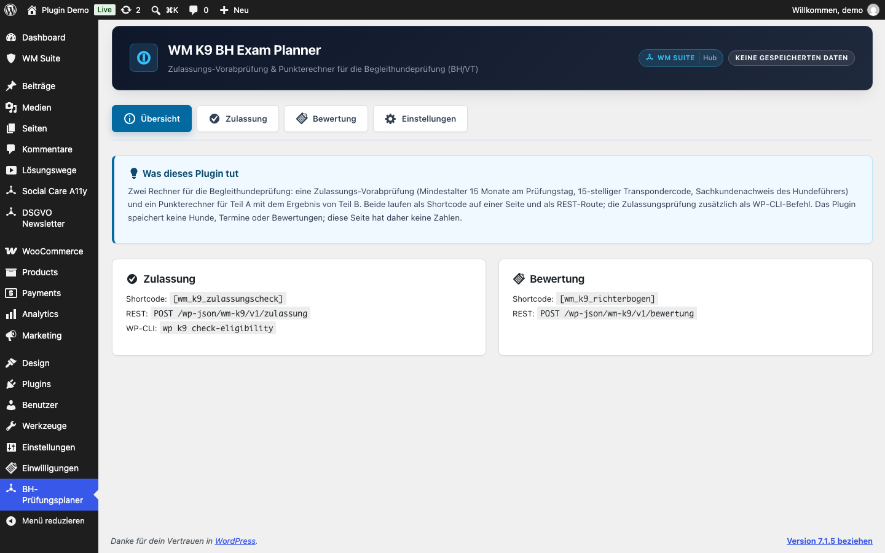

# WM K9 BH Exam Planner (Deutsche Dokumentation)

<p align="center">
  <a href="README.md"></a>
  <a href="README.de.md"></a>
  <a href="README.es.md"></a>
</p>

> **Zulassungs-Vorabprüfung (Alter, 15-stelliger Transpondercode, Sachkundenachweis) und Punkterechner für die Begleithundeprüfung (BH/VT) — als Shortcodes, REST-Routen und WP-CLI-Befehl**  
> **Plugin-Seite:** [https://arnoldwender.com/wordpress-plugins/wm-k9-bh-exam-planner/](https://arnoldwender.com/wordpress-plugins/wm-k9-bh-exam-planner/)  
> **Mit einem agentischen Workflow entwickelt:** entstanden mit KI-Coding-Agenten. Prüfen und testen Sie es wie jeden fremden Code, bevor Sie es produktiv einsetzen.  
> **Support & Haftung:** Kein Support (Zero Support) — reproduzierbare Bugs ausschließlich über [GitHub Issues](https://github.com/arnoldwender/wm-wp-k9-bh-exam-planner/issues) · kein privater Support · OHNE GEWÄHR („AS IS“) / keine Haftung ([SUPPORT.md](SUPPORT.md))

---

## Live-Vorschau

!WM K9 BH Exam Planner Banner

| Verwaltungsseite (`wm-k9-planner`) | Vorabprüfung (`[wm_k9_zulassungscheck]`) |
| --- | --- |
|  | ![Interaktive Vorabprüfung ([wm_k9_zulassungscheck]) mit berechnetem Prüfergebnis im Frontend](.wordpress-org/screenshot-2.png) |
| Administrationsbereich des BH-Prüfungsplaners mit Zulassungskriterien und Teil-A/B-Übersicht | Interaktive Vorabprüfung (`[wm_k9_zulassungscheck]`) mit berechnetem Prüfergebnis im Frontend |

---

## Was das Plugin leistet

1. **Zulassungs-Vorabprüfung:** `WM_K9_Admission_Validator::check_eligibility()` führt drei Prüfungen mit fest hinterlegten Werten aus und liefert `eligible`, `age_months` und alle Ablehnungsgründe. Alter: mindestens 15 volle Kalendermonate am Prüfungstag. Ein Monat ist am Tag mit derselben Zahl wie der Geburtstag vollendet, in einem kürzeren Monat am Ersten des Folgemonats (Lesart von § 187 Abs. 2 und § 188 Abs. 2, 3 BGB, da die Prüfungsordnung keine Zählregel nennt). Beide Daten müssen im Format `JJJJ-MM-TT` existieren (`2024-02-30` oder `2024-00-15` werden abgelehnt), und ein Prüfungsdatum vor dem Geburtsdatum ist ein eigener Grund. Transponder: genau 15 Ziffern nach Entfernen aller anderen Zeichen (reine Formatprüfung — ISO-11784-Nummern haben keine Prüfsumme, und ob der Chip existiert oder zum Hund gehört, wird nicht geprüft). Hundeführer: der Sachkundenachweis (SKN) so, wie der Aufrufer ihn angibt. Zugänge: `[wm_k9_zulassungscheck]`, `POST /wp-json/wm-k9/v1/zulassung` (`birth_date`, `exam_date`, `microchip`, `has_skn`) und `wp k9 check-eligibility --dob=… --exam=… --chip=… --skn=true|false`.
2. **Punkterechner:** `WM_K9_Scoring_Engine::evaluate()` begrenzt die fünf Übungen von Teil A — Leinenführigkeit (15), Freifolge (15), Sitz aus der Bewegung (10), Ablegen mit Herankommen (10), Ablegen unter Ablenkung (10), die Aufteilung der FCI-Prüfungsordnung 2019 —, summiert sie (60), vergleicht die Summe mit 42, bevor sie für die Anzeige gerundet wird (41,96 ist nicht bestanden und wird als 41,96 gezeigt), übernimmt das Ergebnis von Teil B und liefert `BESTANDEN` nur, wenn beide bestanden sind, oder `DISQUALIFIZIERT` bei gesetzter Disqualifikation (ohne Grund: „kein Grund angegeben“). Zugänge: `[wm_k9_richterbogen]` (ohne Disqualifikationsfeld) und `POST /wp-json/wm-k9/v1/bewertung`.
3. **REST-Prüfung & Ratenbegrenzung:** Beide Routen deklarieren Argument-Schemata und Sanitisierung. WordPress antwortet daher mit `400 rest_invalid_param`, bevor gerechnet wird, wenn ein Wahrheitswert nicht `true`/`false`/`1`/`0` ist, wenn Punkte keine Zahl mit Punkt sind oder außerhalb von 0 bis zum Höchstwert der Übung liegen (`14,5`, `16`), oder wenn `birth_date`, `exam_date` oder `microchip` fehlt oder kein Text ist. Öffentliche Aufrufe sind über anonymisierte Transient-Prüfwerte auf 60 Anfragen pro Minute begrenzt (`429 wm_k9_rate_limited`).
4. **Formulare:** Beide Shortcodes senden an dieselbe Seite, behalten die Eingaben und zeigen das Ergebnis darunter: „VORABPRÜFUNG BESTANDEN“ / „NICHT BESTANDEN“ bei der Zulassung, „RECHNERISCH BESTANDEN“ / „NICHT BESTANDEN“ mit Punkten beim Punkterechner. Die Übungsfelder sind anfangs leer und Pflichtfelder, Teil B ist nicht angehakt, das Prüfungsdatum ist das heutige Datum in der Zeitzone der Website. Die Inline-Farben erreichen mindestens 4,5:1.
5. **Verwaltungsseite & Opt-in-Deinstallation:** Menü *BH Exam Planner* (Position 84), Seite `wm-k9-planner` mit vier Tabs: Übersicht, Zulassung, Bewertung sowie *Einstellungen* mit der ausdrücklichen Opt-in-Option `wm_k9_delete_data_on_uninstall` (Standard `0`, sodass `uninstall.php` Optionen standardmäßig erhält). Auf den Admin-Stylesheets der WM-Suite-Familie.
6. **WP-CLI:** `wp k9 status` zeigt Version und die festen Werte; `wp k9 check-eligibility` führt die Zulassungsprüfung aus (Prüfungsdatum standardmäßig heute in der Zeitzone der Website) und endet mit Fehlercode, wenn der Hund nicht zugelassen wäre.
7. **Block Bindings, GenerateBlocks & Hooks:** Registriert die WordPress-6.5+-Block-Bindings-Quelle `wm-k9/exam-info`, das GenerateBlocks-2.x-Dynamic-Tag `{{wm_k9_info}}` sowie Entwickler-Filter (`wm_k9_zulassung_result`, `wm_k9_bewertung_result`, `wm_k9_rest_rate_limit`, `wm_k9_exam_info_value`) und Aktionen (`wm_k9_ready`, `wm_k9_zulassung_checked`, `wm_k9_bewertung_evaluated`).
8. **WM Suite Hub Spoke & Übersetzungen:** `includes/class-k9-spoke-adapter.php` meldet sich über `wm_register_suite_module` samt CycloneDX-1.6-SBOM (`bom.json`) und `self_test`. Übersetzungen werden bei `init` aus 29 `.po`- / `.mo`-Katalogen geladen.

### Nicht enthalten

Keine Terminplanung, keine Hunde- oder Hundeführerdaten, kein Bewertungsarchiv, keine eigenen Tabellen und keine gespeicherten Prüfungsdaten; kein Prüfbericht; keine Prüfsummen- oder Registerprüfung von Chips; keine externen Anfragen; kein Frontend-Stylesheet oder -Skript; keine Prüfung von Impfpass, Vereinsmitgliedschaft oder Teilnehmerzahlen.

---

## Schnellstart

1. Plugin installieren und aktivieren (WordPress 6.4+, PHP 8.1+).
2. `[wm_k9_zulassungscheck]` und / oder `[wm_k9_richterbogen]` auf einer Seite einfügen. Jedes Formular sendet an dieselbe Seite und zeigt das Ergebnis darunter.
3. Aus einem Vereinsformular oder einer App `POST /wp-json/wm-k9/v1/zulassung` oder `/bewertung` aufrufen; Wahrheitswerte als `true`/`false` oder `1`/`0`, Punkte mit Dezimalpunkt. Alles andere bekommt `400 rest_invalid_param`.
4. Auf dem Server: `wp k9 check-eligibility --dob=2024-05-01 --exam=2025-10-01 --chip=276098100123456 --skn=true`.

Klassen, Routen, Befehle, Hooks und bekannte Grenzen: **[README.md](README.md)** (Referenz) und **[DEVELOPERS.md](DEVELOPERS.md)**.

```bash
php tests/test-suite.php         # Standalone-Prüfungen, ohne WordPress
bash tests/run-mutations.sh      # macht jede Korrektur einmal rückgängig; die Suite muss jedes Mal scheitern
```

---

## Bekannte Grenzen

- **Ausgabe der Prüfungsordnung:** Übungen und Höchstpunkte folgen der FCI-Prüfungsordnung 2019. Die FCI-Prüfungsordnung 2025, gültig ab 1. Januar 2025 (der VDH wendet für die Begleithundprüfung die FCI-Regeln an und veröffentlicht diese Ausgabe), bewertet Leinenführigkeit mit 30, Sitz mit 10, Ablegen in Verbindung mit Herankommen mit 10 und Ablegen unter Ablenkung mit 10 Punkten, ohne Freifolge; beide werten Teil A ab 70 % als bestanden und lassen erst danach zu Teil B zu. Punkterechner und Verwaltungsseite sagen das. Die Umstellung auf 2025 ändert Formularfelder und REST-Schlüssel und wartet auf Arnold.
- **Andere Werte:** 15 Monate nennt der VDH als Mindestalter für die Begleithundprüfung; die FCI-Prüfungsordnung überlässt es der Landesorganisation, nicht unter 12 Monaten. Die Monatszählung folgt der BGB-Lesart oben; maßgeblich ist der ausrichtende Verband.
- Die beiden Formulare haben keine Nonce, weil sie nichts speichern oder ändern.
- Die historischen Banner und Mockups von vor dem 19.11.2026 liegen nicht mehr im Repository; sie wurden am 20.11.2026 außerhalb davon archiviert (Release 1.2.0). Die Screenshots liegen in `.wordpress-org/`.

---

## Konformität

- **Keine externen Anfragen:** Daten, Chipnummern und Punkte werden auf der Website berechnet und nirgendwohin gesendet.
- **Datenschutz:** es werden keine Hunde-, Hundeführer- oder Prüfungsdaten gespeichert; Geburtsdaten und Chipnummern existieren nur in der Anfrage, und die Ratenbegrenzung speichert keine Klartext-IP-Adressen.
- **Reichweite:** das Plugin liefert eine Vorabprüfung und eine Summe. Es ist kein amtlicher Richterbogen und ersetzt weder die Zulassungsentscheidung des ausrichtenden Vereins noch das Urteil des Leistungsrichters; nach der FCI-Prüfungsordnung gibt dieser keine Punkte bekannt, sondern nur „Bestanden“ oder „Nicht bestanden“ und das Prädikat.
- **Herkunft der Werte:** FCI-Prüfungsordnung 2019 (Aufteilung der Übungen), FCI-Prüfungsordnung 2025 (70-%-Regel, Alter durch die Landesorganisation, Sachkundeprüfung), VDH (15 Monate), §§ 187, 188 BGB (Monatszählung). Eine Konformität mit ihnen wird weder behauptet noch geprüft.

---

## Lizenz

Vertrieben unter der **GNU General Public License v2 oder neuer** (`GPL-2.0-or-later`).  
Copyright (C) 2026 Arnold Wender.  
