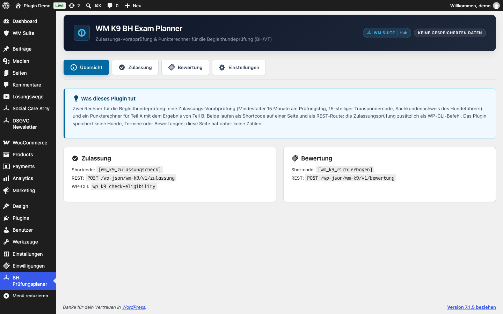
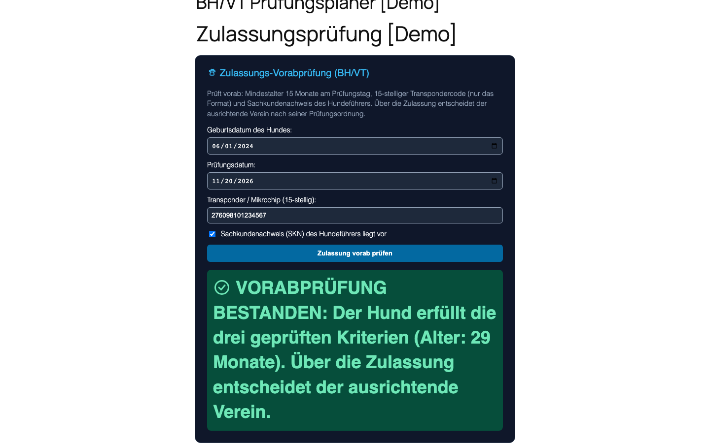

# WM K9 BH Exam Planner (Documentación en Español)

<p align="center">
  <a href="README.md"></a>
  <a href="README.de.md"></a>
  <a href="README.es.md"></a>
</p>

> **Comprobación previa de admisión (edad, código de transpondedor de 15 dígitos, certificado del guía) y calculadora de puntos para la prueba de perro de compañía (Begleithundeprüfung BH/VT) — como shortcodes, rutas REST y un comando WP-CLI**  
> **Página del Plugin:** [https://arnoldwender.com/es/plugins-wordpress/wm-k9-bh-exam-planner/](https://arnoldwender.com/es/plugins-wordpress/wm-k9-bh-exam-planner/)  
> **Desarrollado con un agentic workflow:** creado con agentes de programación de IA. Revísalo y pruébalo como cualquier código de terceros antes de usarlo en producción.  
> **Soporte y responsabilidad:** Cero soporte (Zero Support) — errores reproducibles únicamente en [GitHub Issues](https://github.com/arnoldwender/wm-wp-k9-bh-exam-planner/issues) · sin soporte privado · TAL CUAL («AS IS») / sin responsabilidad ([SUPPORT.md](SUPPORT.md))

---

## Capturas en vivo

!Banner de WM K9 BH Exam Planner

| Panel de administración (`wm-k9-planner`) | Verificador interactivo (`[wm_k9_zulassungscheck]`) |
| --- | --- |
|  |  |
| Panel del planificador BH con requisitos de admisión y puntuación de Parte A / B | Verificador interactivo en el frontend mostrando el veredicto calculado |

---

## Qué hace el plugin

1. **Comprobación previa de admisión:** `WM_K9_Admission_Validator::check_eligibility()` hace tres comprobaciones con valores fijos en el código y devuelve `eligible`, `age_months` y cada motivo de rechazo. Edad: al menos 15 meses naturales completos el día de la prueba. Un mes se completa el día con el mismo número que el del nacimiento, o el primer día del mes siguiente cuando el mes es más corto (lectura de los § 187 Abs. 2 y § 188 Abs. 2, 3 BGB, porque el reglamento no da regla de cómputo). Las dos fechas deben existir en formato `AAAA-MM-DD` (`2024-02-30` o `2024-00-15` se rechazan), y una fecha de prueba anterior al nacimiento es un motivo propio. Transpondedor: exactamente 15 dígitos tras quitar todo lo demás (solo formato: los números ISO 11784 no llevan suma de control, y no se comprueba si el chip existe o pertenece al perro). Guía: el Sachkundenachweis (SKN) tal como lo declara quien llama. Entradas: `[wm_k9_zulassungscheck]`, `POST /wp-json/wm-k9/v1/zulassung` (`birth_date`, `exam_date`, `microchip`, `has_skn`) y `wp k9 check-eligibility --dob=… --exam=… --chip=… --skn=true|false`.
2. **Calculadora de puntos:** `WM_K9_Scoring_Engine::evaluate()` limita los cinco ejercicios de la parte A — Leinenführigkeit (15), Freifolge (15), Sitz aus der Bewegung (10), Ablegen mit Herankommen (10), Ablegen unter Ablenkung (10), el reparto del reglamento FCI de 2019 —, los suma (60), compara la suma con 42 antes de redondearla para mostrarla (41,96 no aprueba y se muestra como 41,96), toma el resultado de la parte B tal como llega y devuelve `BESTANDEN` solo si ambas están aprobadas, o `DISQUALIFIZIERT` si hay descalificación (sin motivo: «kein Grund angegeben»). Entradas: `[wm_k9_richterbogen]` (sin campo de descalificación) y `POST /wp-json/wm-k9/v1/bewertung`.
3. **Validación REST y límite de peticiones:** las dos rutas declaran esquemas de argumentos y saneamiento de cadenas, así que WordPress responde `400 rest_invalid_param` antes de calcular cuando un booleano no es `true`/`false`/`1`/`0`, cuando los puntos no son un número con punto decimal o salen de 0 al máximo del ejercicio (`14,5`, `16`), o cuando falta `birth_date`, `exam_date` o `microchip` o no es texto. Las llamadas públicas están limitadas a 60 peticiones por minuto por huella anónima (`429 wm_k9_rate_limited`).
4. **Formularios:** los dos shortcodes envían a la misma página, conservan lo capturado y muestran el resultado debajo: «VORABPRÜFUNG BESTANDEN» / «NICHT BESTANDEN» para la admisión, «RECHNERISCH BESTANDEN» / «NICHT BESTANDEN» con puntos para la calculadora. Los campos de ejercicios empiezan vacíos y son obligatorios, la parte B empieza sin marcar y la fecha de la prueba es la de hoy en la zona horaria del sitio. Los colores en línea llegan al menos a 4,5:1.
5. **Pantalla de administración y desinstalación opcional:** menú *BH Exam Planner* (posición 84), página `wm-k9-planner` con cuatro pestañas: resumen, admisión, evaluación y *Ajustes* con la opción explícita `wm_k9_delete_data_on_uninstall` (por defecto `0`, de modo que `uninstall.php` conserva las opciones salvo activación expresa). Sobre las hojas admin de la familia WM Suite.
6. **WP-CLI:** `wp k9 status` muestra la versión y los valores fijos; `wp k9 check-eligibility` ejecuta la comprobación de admisión (fecha de prueba por defecto: hoy en la zona horaria del sitio) y termina con código de error si el perro no sería admitido.
7. **Block Bindings, GenerateBlocks y hooks:** registra la fuente de Block Bindings de WordPress 6.5+ `wm-k9/exam-info`, la etiqueta dinámica de GenerateBlocks 2.x `{{wm_k9_info}}` y los filtros (`wm_k9_zulassung_result`, `wm_k9_bewertung_result`, `wm_k9_rest_rate_limit`, `wm_k9_exam_info_value`) y acciones (`wm_k9_ready`, `wm_k9_zulassung_checked`, `wm_k9_bewertung_evaluated`).
8. **Spoke del WM Suite Hub e i18n:** `includes/class-k9-spoke-adapter.php` se registra por `wm_register_suite_module` con SBOM CycloneDX 1.6 (`bom.json`) y `self_test`. Las traducciones se cargan en `init` desde 29 catálogos `.po` / `.mo`.

### No incluido

Sin calendario de pruebas, registros de perros o guías, archivo de puntuaciones, tablas propias ni datos de examen guardados; sin informes de auditoría; sin verificación de suma de control ni de registro de chips; sin peticiones externas; sin hoja de estilos ni script de frontend; sin revisión de cartilla de vacunación, membresía del club ni número de participantes.

---

## Inicio rápido

1. Instala y activa el plugin (WordPress 6.4+, PHP 8.1+).
2. Coloca `[wm_k9_zulassungscheck]` y / o `[wm_k9_richterbogen]` en una página. Cada formulario envía a la misma página y muestra el resultado debajo.
3. Desde un formulario del club o una app, llama a `POST /wp-json/wm-k9/v1/zulassung` o `/bewertung`; booleanos como `true`/`false` o `1`/`0`, puntos con punto decimal. Todo lo demás recibe `400 rest_invalid_param`.
4. En el servidor: `wp k9 check-eligibility --dob=2024-05-01 --exam=2025-10-01 --chip=276098100123456 --skn=true`.

Clases, rutas, comandos, hooks y limitaciones conocidas: **[README.md](README.md)** (referencia) y **[DEVELOPERS.md](DEVELOPERS.md)**.

```bash
php tests/test-suite.php         # comprobaciones standalone, sin WordPress
bash tests/run-mutations.sh      # deshace cada corrección una vez; la suite debe fallar todas las veces
```

---

## Limitaciones conocidas

- **Edición del reglamento:** ejercicios y máximos siguen el reglamento FCI de 2019. El reglamento FCI de 2025, vigente desde el 1 de enero de 2025 (el VDH aplica las reglas FCI a la Begleithundprüfung y publica esta edición), puntúa Leinenführigkeit con 30, Sitz con 10, Ablegen in Verbindung mit Herankommen con 10 y Ablegen unter Ablenkung con 10, sin Freifolge; los dos aprueban la parte A desde el 70 % y solo después admiten a la parte B. La calculadora y la pantalla de administración lo dicen. Cambiar al reparto de 2025 cambia campos del formulario y claves REST y espera a Arnold.
- **Otros valores:** los 15 meses son la edad mínima que indica el VDH para la Begleithundprüfung; el reglamento FCI la deja a la organización nacional, nunca por debajo de 12 meses. El cómputo de meses sigue la lectura del BGB de arriba; decide la asociación organizadora.
- Los dos formularios no llevan nonce porque no guardan ni cambian nada.
- Los banners y mockups históricos de antes del 19.11.2026 ya no están en el repositorio; se archivaron fuera de él el 20.11.2026 (versión 1.2.0). Las capturas están en `.wordpress-org/`.

---

## Conformidad

- **Sin peticiones externas:** fechas, números de chip y puntos se calculan en el sitio y no se envían a ningún lado.
- **Privacidad:** no se escriben datos de perros, guías ni puntuaciones en la base de datos; las fechas de nacimiento y los números de chip solo existen en la petición, y el límite de peticiones no almacena direcciones IP en claro.
- **Alcance:** el plugin da una comprobación previa y una suma. No es una hoja oficial de juez y no sustituye la decisión de admisión del club organizador ni el veredicto del juez; según el reglamento FCI, el juez no anuncia puntos, solo «Bestanden» o «Nicht bestanden» y la calificación.
- **Origen de los valores:** reglamento FCI 2019 (reparto de ejercicios), reglamento FCI 2025 (regla del 70 %, edad fijada por la organización nacional, Sachkundeprüfung), VDH (15 meses), §§ 187, 188 BGB (cómputo de meses). No se afirma ni se prueba conformidad con ninguno.

---

## Licencia

Distribuido bajo la **GNU General Public License v2 o posterior** (`GPL-2.0-or-later`).  
Copyright (C) 2026 Arnold Wender.  
